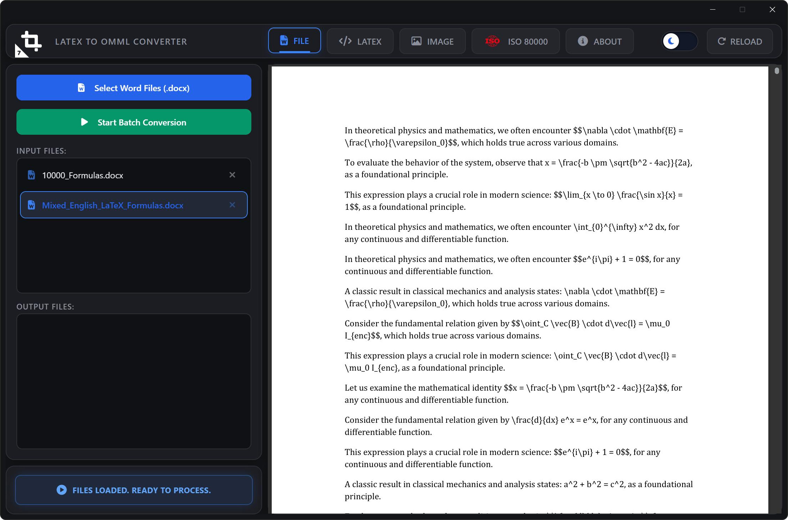
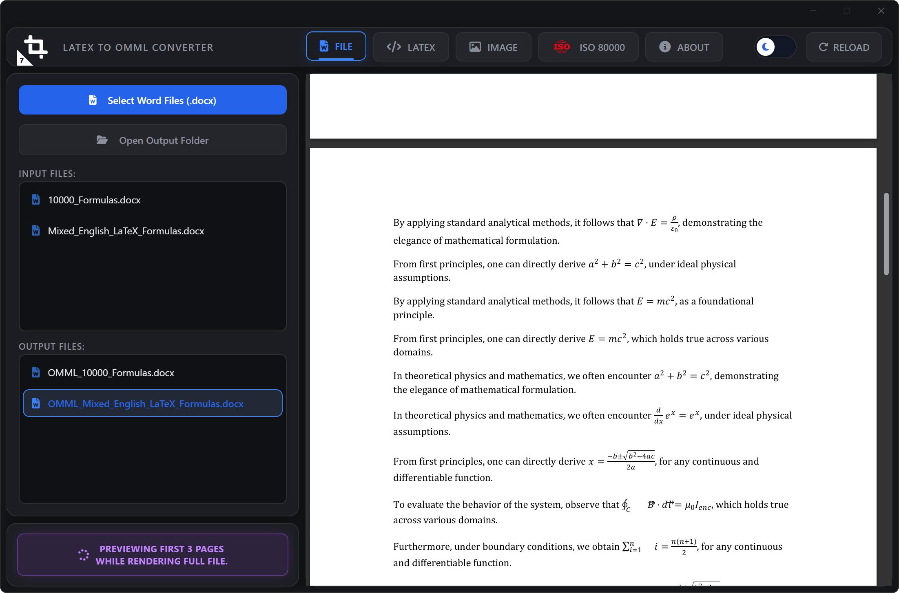
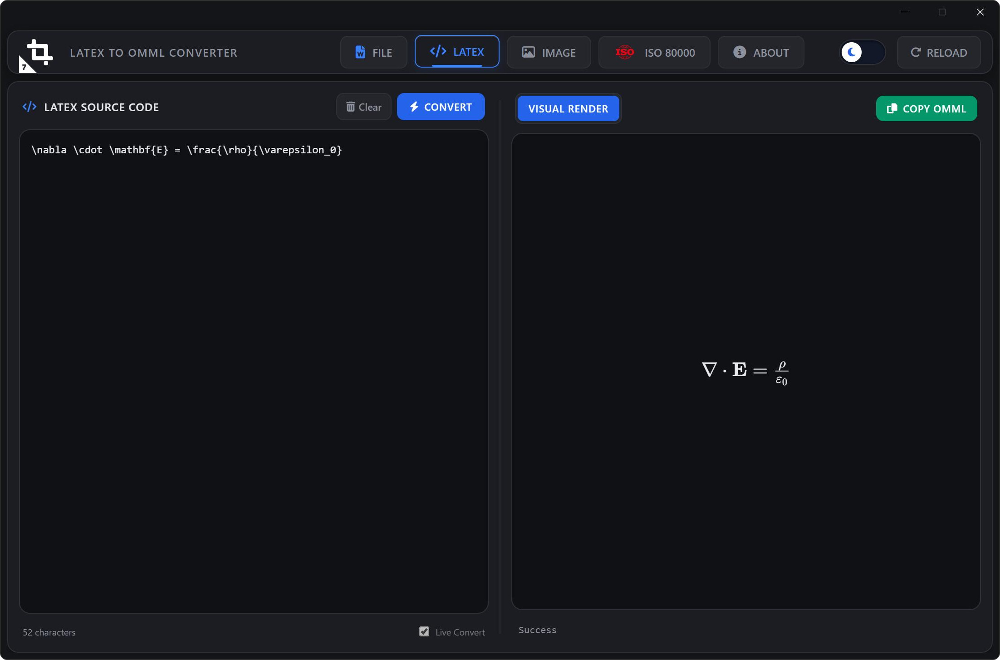
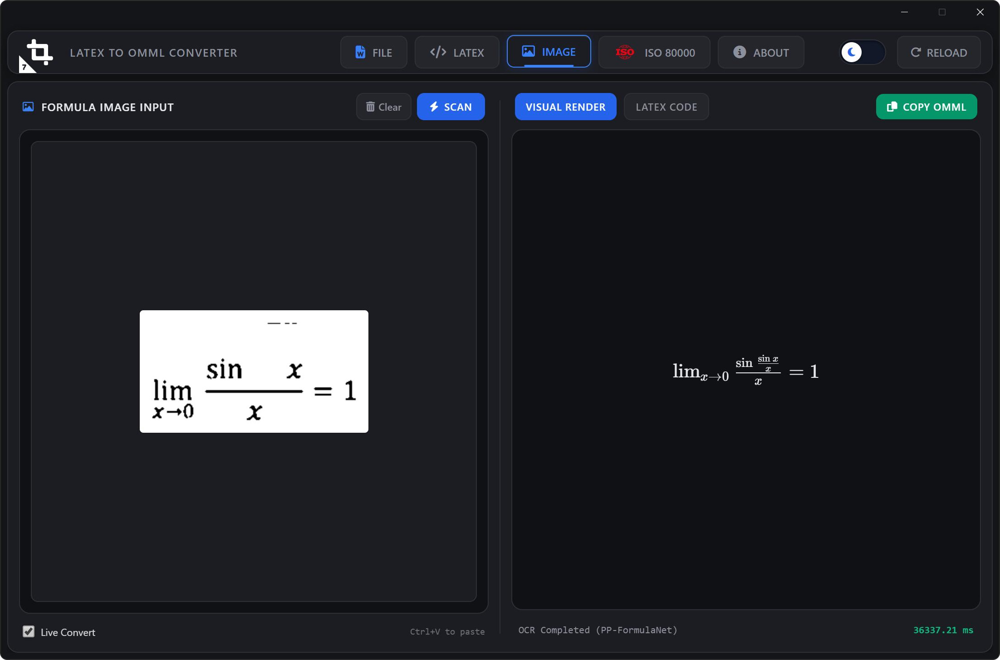
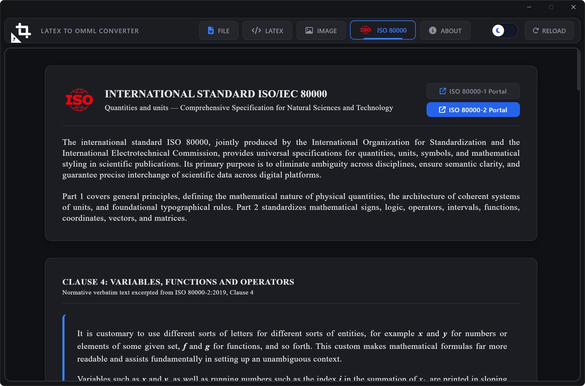

<div align="center">

<table border="0" style="border: none; background: transparent; margin: auto;">
  <tr style="border: none; background: transparent;">
    <td align="center" style="border: none; padding: 10px;">
      
      <br/><sub style="font-size: 13px; line-height: 1.6; display: block; margin-top: 6px;"><b>Q7 LaTeX To OMML</b></sub>
    </td>
    <td align="center" style="border: none; padding: 10px;">
      
      <br/><sub style="font-size: 13px; line-height: 1.6; display: block; margin-top: 6px;"><b>Author: OOPS52 (Capoo)</b></sub>
    </td>
  </tr>
</table>

# Q7 LaTeX To OMML

**High-Performance Hybrid Rust + Python Mathematical Compiler & ISO 80000-2 Native OMML Studio for Microsoft Word**

</div>

A 100% offline desktop application built around two core capabilities:
- **Batch `.docx` Conversion**: Automatically detects LaTeX symbols and formulas inside `.docx` files, converts them into native Word OMML equations, and returns the converted `.docx` output. *(Note: While the engine can detect un-delimited LaTeX code without `$`, wrapping formulas in `$...$` or `$$...$$` is recommended for best accuracy.)*
- **LaTeX / Image OCR to OMML**: Converts raw LaTeX or formula screenshots (via offline OCR) into OMML for direct copy-and-paste (`Ctrl + V`) into Microsoft Word with zero formatting errors.

<div align="center">

*Architected & Engineered by **OOPS52 - QUAST***

[](https://github.com/Oops52VN/LaTeX-To-OMML-Converter)
[](https://opensource.org/licenses/MIT)
[](#absolute-data-security--100-offline-privacy-guarantee)
[](#absolute-data-security--100-offline-privacy-guarantee)

[](#10-getting-started--installation)
[](#2-overview--core-value-proposition)
[-D83B01?style=flat-square&logo=microsoftoffice&logoColor=white)](#6-technical-architecture--deep-dive)
[](#4-iso-80000-2-mathematical-compliance)

</div>

---

## Absolute Data Security & 100% Offline Privacy Guarantee

> **Zero Network Transmission • Zero Telemetry • Zero Cloud Dependency • 100% Air-Gapped Operation**
> 
> **Q7 LaTeX To OMML** is engineered from the ground up for strict confidentiality and air-gapped security environments.
> - **100% Local Execution**: All mathematical parsing, LaTeX AST generation, OMML compiling, image OCR, and Word OpenXML manipulation occur exclusively on your local workstation's CPU and RAM.
> - **Kernel-Level Request Interception**: The internal Chromium browser engine integrates a hard-coded network interrupter (`OfflineInterceptor` in `app/app.py`), which inspects and automatically blocks every outgoing HTTP, HTTPS, WebSocket, and external network packet (`info.block(True)`).
> - **Zero Cloud Telemetry**: The application contains no analytics tracking, no user profiling, no remote telemetry, and no external API pings.
> - **Offline AI OCR Weights**: Neural mathematical recognition models run entirely via local cached weights without transmitting formula screenshots to external cloud servers.
> - **Institutional & Legal Compliance**: Safe for proprietary research, classified defense/aerospace mathematics, confidential national examination questions, and non-disclosure academic manuscripts. Your data never leaves your computer.

---

## 1. Executive Metadata

| Attribute | Specification |
| :--- | :--- |
| **Official Project Title** | **Q7 LaTeX To OMML** |
| **Author & Architect** | **OOPS52 - QUAST** *(Represented by Capoo Avatar)* |
| **Version** | `v11.18.2026` |
| **Target Operating System** | Windows 10 / Windows 11 (64-bit) |
| **Security Architecture** | **100% Offline / Air-Gapped Verified** (`OfflineInterceptor` Blocks All Outgoing Traffic) |
| **Core Runtime Stack** | Hybrid Python (`PyQt5`, `lxml`, `pywin32`, `PaddleOCR`) + Native Rust (`quast_core` via `PyO3` / `Maturin`, `rayon`, `quick-xml`, `zip`, `image`) |
| **Frontend & Preview Stack** | HTML5 / Tailwind CSS / FontAwesome / Bundled KaTeX + Native Microsoft Edge WebView2 (`WebView2Loader.dll`) |
| **Mathematical Standard** | **ISO 80000-1 & ISO 80000-2 Compliant** (`Cambria Math` 2D Professional Layout) |
| **Development Paradigm** | **100% Vibe Coding** via **Google Antigravity** (`Gemini 3.1 Pro` \| `Gemini 3.8 Flash` \| `Gemini 4 Argon`) |
| **Country of Origin** | Vietnam 🇻🇳 |
| **License** | MIT License |
| **Direct Contact** | Telegram [`@OOPS52VN001`](https://t.me/OOPS52VN001) |

---

## 2. Overview & Core Value Proposition

### 2.1. Problem Statement
Scientific authors, educators, examination boards, and engineers frequently draft mathematical expressions in **LaTeX**—or receive LLM-generated manuscripts containing hundreds of `$...$` and `$$...$$` segments—while final publication workflows demand editable **Microsoft Word (`.docx`)** documents. Existing conversion workflows suffer from severe structural flaws:
- **Font Corruption & Glyph Substitution**: Third-party equation plugins embed proprietary bitmap/OLE objects or legacy PostScript fonts that break when opened on machines without the plugin installed.
- **Baseline Misalignment & Flat 1D Delimiters**: Naive MathML-to-Word converters emit non-stretchy ASCII parentheses `(` and `)` instead of true 2D `<m:d>` delimiter containers, causing tall fractions, matrices, and binomials to overflow their fences.
- **Non-Standard Mathematical Typography**: Variables, mathematical constants ($\mathrm{e}, \mathrm{i}, \pi$), differential operators ($\mathrm{d}x$), and standard functions ($\sin, \cos, \ln, \lim$) are frequently rendered with inconsistent italicization, violating international **ISO 80000-2** publication rules.
- **Single-Threaded Bottlenecks**: Pure-Python DOM parsers freeze when processing multi-megabyte `.docx` examination banks containing thousands of equations.

### 2.2. Practical Solution
**Q7 LaTeX To OMML** serves as a high-throughput, zero-dependency-lock-in bridge between LaTeX syntax and Microsoft Word's native **Office Math Markup Language (OMML — `<m:oMath>` / `<m:oMathPara>`)**. Equations produced by Q7 are 100% native Word objects rendered in `Cambria Math`, maintaining crisp vector typography, exact baseline alignment, stretchy 2D delimiters, and full editability inside Microsoft Word 2016/2019/2021/2024/365 on any computer.

### 2.3. Primary Use Cases
1. **Instant Clipboard Conversion & Direct Word Paste (`LATEX` Studio)**:
   Type or paste raw/delimited LaTeX, inspect the live KaTeX preview, and click **COPY OMML** to register both `"MathML Presentation"` and `CF_UNICODETEXT` on the native Windows Clipboard—allowing a single `Ctrl + V` inside Microsoft Word to insert a native inline or block 2D equation.
2. **Offline Formula Image OCR to OMML (`IMAGE` Studio)**:
   Import screenshots or camera captures of mathematical formulas (supporting both Light Mode and Dark Mode captures). The native Rust preprocessor (`binarize.rs`, `denoise.rs`, `crop.rs`) cleans the image in `<8ms` before the offline OCR pipeline reconstructs the LaTeX AST and compiles it directly into copyable OMML.
3. **High-Speed Multi-Core Batch `.docx` Conversion (`FILE` Mode)**:
   Drag and drop multiple `.docx` documents containing raw or delimited LaTeX formulas. Powered by the **Rust `quast_core` accelerator** (`rayon` data parallelism + `quick-xml` zero-DOM streaming + 2-tier deduplication cache), Q7 converts thousands of formulas into ISO-compliant 2D OMML in seconds while rendering an interactive **Microsoft Edge WebView2** PDF preview of the resulting Word document.

---

## 3. User Interface & Feature Showcase

The user interface (`resources/UI/UI.html`) is built around a **5-color minimalist design system** featuring hardware-accelerated transitions, synchronized Windows DWM native caption color interpolation, an adaptive header logo (`resources/UI/assets/logo.png`), and instant switching between **Dark Mode** and **Light Mode**.

---

### 3.1. High-Speed Batch DOCX Engine & Native Edge PDF Viewer (`FILE` Tab)

<div align="center">
  
  <p><em>Figure 1: Batch DOCX Converter with 5-State Lifecycle Badge and Embedded Edge WebView2 PDF Viewer</em></p>
</div>

<div align="center">
  
  <p><em>Figure 2: Completed Batch DOCX Conversion with Output File Queue and Live Word OMML PDF Preview</em></p>
</div>

- **Drag-and-Drop Multi-File Queue**: Load one or dozens of `.docx` files simultaneously. Clean, bullet-free file lists separate **Input Files** from converted **Output Files (`OMML_*.docx`)**.
- **Rust-Accelerated Streaming Conversion**: Scans and transforms `word/document.xml` in parallel across all CPU cores without holding the Python GIL, preserving 100% of document styles (`<w:pPr>`), tables, headers, and embedded media (`raw_copy_file`).
- **5-State Uppercase Lifecycle Notice Badge**: Provides deterministic visual feedback across every stage of the pipeline:
  1. `NO FILES LOADED. PLEASE ADD A FILE TO BEGIN.`
  2. `FILES LOADED. READY TO PROCESS.`
  3. `PROCESSING FILES. PLEASE WAIT...`
  4. `PREVIEWING FIRST 3 PAGES` / `WHILE RENDERING FULL FILE.`
  5. `DONE`
- **Embedded Microsoft Edge WebView2 PDF Viewer (`app/edge_pdf_viewer.py`)**: Binds `ICoreWebView2Controller` via `resources/bin/WebView2Loader.dll` directly onto a native Win32 child `HWND` inside the preview pane. Powered by a pre-warmed background `PersistentWordPdfEngine` and a **Two-Stage 3-Page Progressive Export** (`From=1, To=3` in `<1.5s`, followed by seamless background full-document hot-swap), users can scroll, zoom (`Ctrl + Wheel`), and inspect exact Word pagination without opening an external viewer.

---

### 3.2. Single Formula Converter & KaTeX Live Preview (`LATEX` Tab)

<div align="center">
  
  <p><em>Figure 3: Real-Time LaTeX AST Studio with Offline KaTeX Visual Render and One-Click Word OMML Clipboard</em></p>
</div>

- **Interactive LaTeX Code Editor**: Supports raw un-delimited LaTeX, inline `$...$` / `\(...\)`, display `$$...$$` / `\[...\]`, and multi-line environments (`aligned`, `align`, `cases`, `pmatrix`, `bmatrix`, `vmatrix`).
- **Real-Time Offline KaTeX Rendering**: Powered by the bundled `resources/UI/assets/katex/` engine (with 20 local `.woff2` math fonts) for zero-latency visual verification and instant syntax error highlighting.
- **One-Click Native Word Clipboard (`COPY OMML`)**: Writes directly to the Windows OS clipboard via `win32clipboard`, automatically distinguishing inline equations (`display="inline"` -> `wdOMathJcInline`) from display equations (`display="block"` -> `wdOMathJcCenter`) when pasted into Microsoft Word.

---

### 3.3. Offline Formula Image-to-OMML Engine (`IMAGE` Tab)

<div align="center">
  
  <p><em>Figure 4: Offline Mathematical Image OCR Studio with Rust Preprocessing and Dual Visual/LaTeX Output</em></p>
</div>

- **Multi-Format Formula Image Input**: Import `PNG`, `JPG`, `BMP`, or `WEBP` captures via file picker, drag-and-drop, or direct clipboard paste (`Ctrl + V`), with an **Auto-convert on image import** toggle enabled by default.
- **Pure-Rust Preprocessing Pipeline (`core/src/image_proc/`)**: Automatically detects and inverts Dark Mode screenshots (`>55%` dark background pixels), applies a branchless $3 \times 3$ sorting-network median filter (`denoise.rs`), computes $O(1)$ integral-image adaptive Sauvola thresholding (`binarize.rs`), and auto-crops the ink bounding box (`crop.rs`).
- **Dual Output Inspection & Copy**: Inspect both the rendered **VISUAL RENDER** and extracted **LATEX CODE**, then click **COPY OMML** to paste the reconstructed equation straight into Word.

---

### 3.4. Interactive ISO 80000-2 Specification & System Configuration (`ISO 80000` View)

<div align="center">
  
  <p><em>Figure 5: Built-In ISO 80000-1 & ISO 80000-2 Digital Standard Reference and Dual-Theme Interface</em></p>
</div>

- **Built-In ISO 80000 Digital Reference (`#view-iso`)**: Accessible directly from the header bar (`resources/UI/assets/iso.svg`), presenting the complete English typographic specification and symbol clauses of **ISO 80000-1** and **ISO 80000-2** formatted in formal `12pt Times New Roman` justified layout with direct links to `iso.org`.
- **ISO Normalization & Typography Defaults**: Enforces `Cambria Math` styling, automatic upright operator/function romanization (`<m:sty m:val="p"/>`), thin-space insertion (`\,`) after trigonometric/logarithmic operators, and 2D stretchy fence promotion (`<m:d>`).

---

## 4. ISO 80000-2 Mathematical Compliance

Every equation compiled by **Q7 LaTeX To OMML**—whether through the direct AST compiler (`app/latex_omml_engine.py`) or the XSLT tree normalizer (`fix_mathml_tree` in `app/app.py`)—strictly enforces **ISO 80000-2:2019** (*Quantities and units — Part 2: Mathematics*) typographic conventions inside Microsoft Word's OMML schema:

### 4.1. Core Typographic Rules in OMML Output
1. **Scalar Variables & Running Indices (Italic)**:
   Physical quantities, algebraic variables ($x, y, z, a, b, c$), and running indices ($i, j, k, n$) are emitted with default italic math style or explicit `<m:sty m:val="i"/>`.
2. **Mathematical Constants (Upright / Roman)**:
   Universal mathematical constants whose values never change—Euler's number ($\mathrm{e}$), the imaginary unit ($\mathrm{i}$), and Archimedes' ratio ($\pi$ when styled upright)—are supported via `\mathrm{e}`, `\mathrm{i}` producing `<m:sty m:val="p"/>` (plain/upright).
3. **Differential Operators (Upright / Roman)**:
   The differential operator in integrals and derivatives ($\mathrm{d}x, \mathrm{d}t, \frac{\mathrm{d}y}{\mathrm{d}x}$) is rendered upright (`<m:sty m:val="p"/>`) to distinguish the operator $\mathrm{d}$ from a scalar variable $d$.
4. **Standard Mathematical Functions & Operators (Upright + Thin Space)**:
   Explicitly defined multi-letter functions ($\sin, \cos, \tan, \cot, \arcsin, \ln, \log, \exp, \lim, \max, \min, \det, \gcd, \sup, \inf$) are compiled into dedicated `<m:func><m:fName>` or `<m:limLow>` containers with `<m:rPr><m:sty m:val="p"/></m:rPr>` and normalized inter-argument spacing (`\sin\, x`).
5. **Vectors, Tensors & Matrices (Bold Upright / Bold Italic)**:
   Vectors ($\mathbf{v}, \vec{a}$) and matrices ($\mathbf{A}$) mapped via `\mathbf{...}` emit `<m:sty m:val="b"/>` (bold upright) or `<m:sty m:val="bi"/>` (bold italic) according to tensor hierarchy.
6. **2D Stretchy Delimiters & Superscripted Fences**:
   Matched parentheses `(...)`, brackets `[...]`, and braces `\{...\}` (both explicit `\left...\right` and standard fences) are grouped into AST `DelimNode` / `<m:d>` structures so they scale vertically to match nested fractions, integrals, and matrices, while superscripted fences like `(-1)^k` wrap `<m:d>` inside `<m:sSup><m:e>` so exponents attach to the top-right corner of the 2D bracket.

### 4.2. ISO 80000-2 Transformation Mapping Table

| Mathematical Category | Input LaTeX Syntax | ISO 80000-2 Processing & Normalization | Word OMML XML Structure | Rendered Word Appearance |
| :--- | :--- | :--- | :--- | :---: |
| **Variables & Quantities** | `f(x, y) = ax^2 + by` | Tokenized as `IDENT` -> Italic math run; `(x, y)` promoted to 2D `<m:d>` | `<m:r><m:t>x</m:t></m:r>` (default italic) | $f(x, y) = ax^2 + by$ |
| **Mathematical Constants** | `e^{\mathrm{i}\pi} + 1 = 0` | `\mathrm{i}` mapped to upright plain style (`m:val="p"`) | `<m:r><m:rPr><m:sty m:val="p"/></m:rPr><m:t>i</m:t></m:r>` | $e^{\mathrm{i}\pi} + 1 = 0$ |
| **Differential Operator** | `\int_0^1 x^2 \,\mathrm{d}x` | Integral mapped to `<m:nary>`; `\mathrm{d}` emitted upright before italic $x$ | `<m:nary>...</m:nary>` + `<m:sty m:val="p"/>` on `d` | $\int_0^1 x^2 \,\mathrm{d}x$ |
| **Standard Functions** | `\sin x + \ln y` | Rust/Python normalizer expands to `\sin\, x`; `FuncNode` sets upright `<m:fName>` | `<m:func><m:fName><m:r><m:rPr><m:sty m:val="p"/></m:rPr><m:t>sin</m:t></m:r></m:fName><m:e>...</m:e></m:func>` | $\sin\,x + \ln\,y$ |
| **Limit Operators** | `\lim_{x \to 0} \frac{\sin x}{x}` | Parsed as `LimNode` with upright `lim` and underscript `<m:lim>` | `<m:limLow><m:e><m:r><m:rPr><m:sty m:val="p"/></m:rPr><m:t>lim</m:t></m:r></m:e><m:lim>x→0</m:lim></m:limLow>` | $\lim_{x \to 0} \frac{\sin x}{x}$ |
| **Vectors & Matrices** | `\mathbf{A}\mathbf{x} = \mathbf{b}` | `\mathbf` sets bold upright style attribute on run | `<m:r><m:rPr><m:sty m:val="b"/></m:rPr><m:t>A</m:t></m:r>` | $\mathbf{A}\mathbf{x} = \mathbf{b}$ |
| **2D Stretchy Delimiters** | `\left( \frac{a}{b} \right)^n` | Fence grouping wraps `<m:d>` inside `<m:sSup><m:e>` | `<m:sSup><m:e><m:d><m:dPr><m:begChr m:val="("/>...</m:dPr><m:e><m:f>...</m:f></m:e></m:d></m:e><m:sup>n</m:sup></m:sSup>` | $\left( \frac{a}{b} \right)^n$ |

---

## 5. Feature Comparison Matrix

| Evaluation Criterion | **Q7 LaTeX To OMML** | **MS Word Built-In (`Alt + =`)** | **MathType (Commercial)** | **Pandoc (CLI)** |
| :--- | :--- | :--- | :--- | :--- |
| **Core Execution Engine** | **Hybrid Rust (`PyO3` + `rayon`) + Python Direct AST** | Internal Word C++ Linear Parser | Desktop GUI / Java / COM Add-in | Haskell AST CLI |
| **Data Privacy & Telemetry** | **100% Offline Air-Gapped (Zero Network Packets)** | Transmits Office 365 Connected Experiences | Periodic online activation check | Offline CLI |
| **Batch `.docx` Speed (1,000+ Eqs)** | **Ultra-Fast (`~4.0s` cold / `0.02s` cached)** | Manual one-by-one typing / slow macro | Slow (sequential Word COM automation) | Moderate (rebuilds entire `.docx` styles) |
| **Preserves Original `.docx` Layout** | **100% (Zero-DOM `quick-xml` stream + `raw_copy`)** | N/A (Manual editing) | Partial (often alters line spacing) | No (overwrites Word templates/margins) |
| **ISO 80000-2 Compliance** | **Automatic (`m:sty="p"`, 2D `<m:d>` fences, `\sin\,x`)** | Partial (often flattens nested fences) | Manual style configuration required | Partial (lacks superscripted `<m:d>` lifting) |
| **Offline Math Image OCR** | **Built-in (Rust Sauvola + `PP-FormulaNet` / 2D Layout)** | None | None | None |
| **Embedded Native PDF Preview** | **Built-in (Edge WebView2 + 3-Page Progressive Export)** | Native Word viewport | None | None |
| **Direct Word Clipboard Paste** | **One-Click (`MathML Presentation` + `CF_UNICODETEXT`)** | Manual paste + linear conversion trigger | Uses proprietary OLE or MathML clip | None (file-to-file CLI only) |
| **Licensing & Cost** | **Free & Open-Source (MIT License)** | Bundled with MS Office subscription | Commercial subscription (~$50+/year) | Free & Open-Source (GPL) |

---

## 6. Technical Architecture & Deep Dive

### 6.1. Dual-Path LaTeX -> MathML / AST -> OMML Compilation Pipeline
Q7 employs a dual-engine mathematical compilation strategy engineered for both microsecond single-formula latency and high-throughput document conversion:
1. **Primary Direct AST-to-OMML Compiler (`app/latex_omml_engine.py`)**:
   - **Stage 1 (Multi-Mode Segmenter & Preprocessor)**: Distinguishes pure un-delimited LaTeX, inline `$...$` / `\(...\)`, and display `$$...$$` / `\[...\]`, expanding structural macros (`\dfrac`, `\tfrac`, `\cfrac`, `\binom`, `\mathbb`, `\mathbf`, `\mathrm`, `\operatorname`).
   - **Stage 2 (`LaTeXLexer`)**: Zero-backtracking lexical scanner emitting strongly typed tokens for commands, groups, scripts, primes, alignment tabs (`&`), and row breaks (`\\`).
   - **Stage 3 (Recursive-Descent `LaTeXParser` with $O(N)$ Stack Fence Grouping)**: Builds a typed AST (`FracNode`, `SqrtNode`, `NaryNode`, `LimNode`, `FuncNode`, `DelimNode`, `AccentNode`, `MatrixNode`, `CasesNode`, `EqArrayNode`) and pairs matching `()`, `[]`, `{}` delimiters in a single linear $O(N)$ stack pass.
   - **Stage 4 (`OMMLBuilder` & `MathMLPreviewBuilder`)**: Directly constructs `lxml.etree` `<m:oMath>` / `<m:oMathPara>` XML nodes and Presentation MathML without invoking external XSLT stylesheets (`~0.1ms` per formula, backed by an in-memory LRU cache and 2-tier persistent disk cache `FormulaOmmlCache`).
2. **XSLT Stylesheet Pipeline (`resources/xsl/MML2OMML.XSL` & `OMML2MML.XSL`)**:
   - Locate-aware XSLT resolver (`locate_xslt()` in `app/app.py`) automatically discovers Microsoft Office's native `MML2OMML.XSL` or falls back to the bundled `resources/xsl/MML2OMML.XSL` (paired with `OMML2MML.XSL` for bidirectional compatibility and single-pass post-order `fix_mathml_tree` normalization).
3. **Native Windows Clipboard Registration (`copy_omml_to_clipboard` in `app/app.py`)**:
   - Bypasses Chromium's sandboxed `navigator.clipboard` restrictions by invoking `win32clipboard` in Python, simultaneously registering the custom Windows clipboard format `"MathML Presentation"` (UTF-16LE encoded with XML declaration) and `CF_UNICODETEXT` (raw `<m:oMath>` XML).

### 6.2. Native Rust PyO3 Accelerator (`core/` — `quast_core`)
Compiled into a native C-ABI extension (`_quast_core.pyd` via `PyO3 0.22` with `abi3-py38`, `opt-level = 3`, and `lto = "fat"`), `quast_core` releases the Python GIL (`py.allow_threads`) across three compute-intensive subsystems:
- **Zero-Copy SIMD Formula Tokenizer (`core/src/tokenizer/`)**:
  - `scanner.rs`: Single-pass byte state machine using `memchr` that extracts `$...$`, `$$...$$`, `\(...\)`, `\[...\]`, and pure un-delimited LaTeX paragraphs while shielding fenced code blocks (```` ```...``` ````), inline code (`` `...` ``), escaped `\$`, and currency numbers (`$100`). Benchmarks at **220.63 MB/s** (**8.16x faster** than Python `re`).
  - `normalizer.rs`: Pre-compiled `once_cell::sync::Lazy<Regex>` normalizer injecting ISO thin spaces (`\,`) into trigonometric and logarithmic expressions.
- **Pure-Rust Math Image Preprocessing (`core/src/image_proc/`)**:
  - `mod.rs`: Zero-copy buffer ingestion (`&[u8]`) with automatic border/median luminance analysis that detects and inverts Dark Mode screenshots (`>55%` dark pixels) into crisp black ink on white background.
  - `denoise.rs`: Multi-threaded `rayon` $3 \times 3$ median filter implemented with an optimal **19-swap branchless 9-element sorting network** (`fast_median_9`) that eliminates salt-and-pepper noise without blurring thin fraction bars or minus signs.
  - `binarize.rs`: Parallel global Otsu thresholding (`binarize_otsu`) and **$O(1)$-per-pixel Adaptive Sauvola Binarization** (`binarize_sauvola`) powered by twin 64-bit Integral Images ($S_1 = \sum I$, $S_2 = \sum I^2$) computing local mean and standard deviation across arbitrary window sizes in constant time.
  - `crop.rs`: Foreground ink bounding-box detector (`auto_crop_formula`) that trims excess whitespace and pads standardized margins in **7.48 ms/image (133.6 FPS)**.
- **Streaming OpenXML & Parallel Batch Engine (`core/src/docx_engine/`)**:
  - `batch_runner.rs`: Implements a **Three-Phase Lock-Free Map-Reduce Architecture** over `rayon::par_iter()`:
    1. *Phase 1*: Parallel extraction of unique LaTeX formulas across all input `.docx` archives into per-thread `HashSet` instances reduced into a deduplicated master list.
    2. *Phase 2*: Compilation of unique formulas into an `omml_map: HashMap<String, String>`.
    3. *Phase 3*: Concurrent streaming transformation of every `.docx` archive using `zip::ZipWriter::raw_copy_file()` so embedded images, media, and style sheets are copied as raw compressed Deflate streams with zero decompression/recompression overhead.
  - `xml_stream.rs`: Event-driven `quick-xml` `Reader`/`Writer` pipeline (`transform_document_xml`) that streams `word/document.xml` in constant $O(1)$ paragraph memory, preserving `<w:pPr>` paragraph properties and interleaving `<w:r><w:t>` text runs with raw `<m:oMath>` XML bytes.
  - `preview_patch.rs`: Streams `word/settings.xml` to inject `<w:view w:val="print"/>`, `<w:zoom w:percent="100"/>`, and `<w:documentProtection w:edit="readOnly"/>`.

### 6.3. Embedded WebView2 & Pre-Warmed Word COM Preview Architecture
- **Frontend UI (`QWebEngineView` + `QWebChannel`)**: Hosts `resources/UI/UI.html` with `OfflineInterceptor` blocking all external network traffic for 100% offline privacy.
- **Native Edge PDF Viewer (`app/edge_pdf_viewer.py`)**: Uses low-level `ctypes` COM vtable bindings (`ICoreWebView2Environment`, `ICoreWebView2Controller`, `ICoreWebView2Settings7`) loaded via `resources/bin/WebView2Loader.dll` to mount Microsoft Edge's native PDF renderer directly over the `#view-pdf` container, synchronized at 60 FPS via `ResizeObserver` and DPI scaling (`update_geometry_dip`).
- **Pre-Warmed `PersistentWordPdfEngine` (`app/app.py`)**: Runs a dedicated background STA thread initialized 3 seconds after window launch (`QTimer.singleShot(3000, ...)` to eliminate the Windows `IDC_APPSTARTING` busy cursor). Opens isolated `%TEMP%` copies (`ReadOnly=True`, `Pagination=False`) to prevent Windows `os error 32` file locks and exports pages `1..3` first for sub-1.5s Time-to-First-Page before completing full-document export in the background.

---

## 7. System Architecture & Data Flow Diagrams

*(See details in the README on GitHub: [LaTeX-To-OMML-Converter](https://github.com/Oops52VN/LaTeX-To-OMML-Converter))*

---

## 8. Project Directory Structure & Component Roles

### 8.1. High-Level Repository Hierarchy

```text
Q7 LaTeX To OMML/
├── README.md                             # Comprehensive architectural & user documentation
├── requirements.txt                      # Python package dependencies
├── install.bat                           # Automated environment installer (+ optional Rust maturin build)
├── run.bat                               # Silent desktop application launcher (pythonw app\app.py)
├── tree.txt                              # Strictly aligned single-line full project tree & linkage table
├── .gitignore                            # Git exclusion rules for caches, build artifacts, and venvs
├── .agent/                               # AI Vibe Coding governance rules, plans, walkthroughs & prompt logs
├── releases/                             # Target directory for standalone packaged installers
├── screenshots/                          # Application interface screenshots and visual figures
│   ├── Figure_Docx_1.png                 # Batch DOCX engine and embedded Edge WebView2 PDF preview
│   ├── Figure_Docx_2.png                 # Batch DOCX conversion queue and converted output preview
│   ├── Figure_LaTeX.png                  # LaTeX studio with live KaTeX visual render and OMML copy
│   ├── Figure_IMAGE.png                  # Offline math image OCR studio with Rust image preprocessing
│   └── Figure_ISO.png                    # Built-in ISO 80000 typography specification and symbol rules
├── app/                                  # Python Orchestration & Compilation Engines
│   ├── app.py                            # Main GUI controller, QWebChannel bridge, Word COM engine & workers
│   ├── latex_omml_engine.py              # Standalone 5-stage Direct LaTeX -> AST -> OMML compiler
│   ├── image_omml_engine.py              # Offline Math OCR pipeline, 2D layout analyzer & normalizer
│   └── edge_pdf_viewer.py                # Native Win32 Edge WebView2 PDF preview widget (ctypes COM)
├── core/                                 # Native Rust PyO3 Accelerator Crate (quast_core)
│   ├── Cargo.toml                        # Rust crate manifest (pyo3, rayon, zip, quick-xml, regex, image)
│   ├── Cargo.lock                        # Locked Rust dependency graph
│   ├── pyproject.toml                    # Maturin PEP 517 build configuration
│   ├── python/quast_core/                # Python package wrapper & .pyi type stubs
│   └── src/                              # Rust native source modules
│       ├── lib.rs                        # PyO3 module registration & Rayon thread-pool initializer
│       ├── error.rs                      # Unified QuastError / QuastResult error handling
│       ├── docx_engine/                  # Parallel DOCX batch runner, Quick-XML streamer & preview patcher
│       ├── image_proc/                   # Auto-invert, 3x3 median denoise, O(1) Sauvola binarize & crop
│       └── tokenizer/                    # Zero-copy SIMD formula scanner & ISO function normalizer
└── resources/                            # Runtime Static Assets, Stylesheets & Test Datasets
    ├── UI/                               # Web-native frontend (UI.html, tailwind.js, fontawesome, katex/)
    ├── xsl/                              # Microsoft MML2OMML.XSL & OMML2MML.XSL stylesheets
    ├── bin/                              # Native WebView2Loader.dll binary
    ├── icons/                            # Project branding & author avatar (logo.jpg, author_avatar.jpg)
    └── files/                            # Stress-test dataset (10000_Formulas.docx)
```

> **Full File-by-File Architectural Reference**: For a 100% exhaustive, line-by-line annotated directory tree and component interconnection matrix covering every file in the repository, please consult **[`tree.txt`](tree.txt)**.

### 8.2. Core File Responsibilities

| File Path | Architectural Layer | Functional Responsibility |
| :--- | :--- | :--- |
| [`app/app.py`](app/app.py) | Python Orchestrator | Application entry point (`WebMainWindow`), `OfflineInterceptor` (100% local network block), `QWebChannel` JavaScript-to-Python slot bridge (`Backend`), 2-tier `FormulaOmmlCache`, `ConversionWorker`, `ImageOcrWorker`, `PersistentWordPdfEngine`, and native `win32clipboard` integration. |
| [`app/latex_omml_engine.py`](app/latex_omml_engine.py) | Python Math Compiler | Standalone 5-stage Direct LaTeX-to-OMML AST compiler (`LaTeXLexer` -> `LaTeXParser` -> `OMMLBuilder` / `MathMLPreviewBuilder`) enforcing ISO 80000-2 upright functions and stretchy 2D `<m:d>` fences without external XSLT. |
| [`app/image_omml_engine.py`](app/image_omml_engine.py) | Python OCR Engine | End-to-end offline mathematical image OCR pipeline combining Rust preprocessing, `PP-FormulaNet` / `Structural2DMathExtractor` fallback, `OCRLaTeXNormalizer`, and throttled 60-FPS-safe worker execution. |
| [`app/edge_pdf_viewer.py`](app/edge_pdf_viewer.py) | Python Native UI Host | Embeds Microsoft Edge WebView2 (`ICoreWebView2Controller`) inside a Qt `QWidget` via `ctypes` COM vtable bindings against `WebView2Loader.dll` for interactive PDF previewing. |
| [`core/src/lib.rs`](core/src/lib.rs) | Rust PyO3 Entry | Registers `_quast_core` native functions and classes (`FormulaSegment`, `PyBatchResult`, `PreprocessedImageResult`) and configures the global `rayon` thread pool. |
| [`core/src/docx_engine/batch_runner.rs`](core/src/docx_engine/batch_runner.rs) | Rust DOCX Engine | Executes lock-free `rayon` parallel unique formula extraction (`extract_unique_formulas_from_batch`) and multi-core `.docx` streaming conversion (`convert_batch_parallel`) with `zip::raw_copy_file`. |
| [`core/src/docx_engine/xml_stream.rs`](core/src/docx_engine/xml_stream.rs) | Rust XML Streamer | Event-driven `quick-xml` parser and writer (`transform_document_xml`) that rewrites LaTeX segments inside `<w:p>` into `<m:oMath>` nodes in constant memory. |
| [`core/src/tokenizer/scanner.rs`](core/src/tokenizer/scanner.rs) | Rust SIMD Tokenizer | Single-pass zero-copy state machine (`scan_text_zero_copy`) and heuristic detector (`is_pure_latex_formula`) for delimited and raw LaTeX expressions. |
| [`core/src/image_proc/`](core/src/image_proc/mod.rs) | Rust Image Processor | Pure-Rust dark-background auto-inversion, 9-element sorting-network $3 \times 3$ median denoising (`denoise.rs`), $O(1)$ integral-image Sauvola binarization (`binarize.rs`), and auto-cropping (`crop.rs`). |
| [`resources/xsl/MML2OMML.XSL`](resources/xsl/MML2OMML.XSL) | XSLT Stylesheet | Official Microsoft Office MathML-to-OMML XSLT transformation stylesheet (bundled alongside `OMML2MML.XSL` for systems where Office registry paths are non-standard). |
| [`resources/files/10000_Formulas.docx`](resources/files/10000_Formulas.docx) | Benchmark Dataset | Real-world 10,000-formula Microsoft Word stress-test corpus covering algebra, calculus, matrices, differential equations, and physics notation. |

---

## 9. Performance Testing & 10,000-Formula Benchmark

### 9.1. The `10000_Formulas.docx` Stress-Test Dataset
Bundled directly inside [`resources/files/10000_Formulas.docx`](resources/files/10000_Formulas.docx) is a comprehensive stress-test document containing **10,000 real-world LaTeX mathematical expressions** spanning:
- Nested fractions (`\dfrac`, `\cfrac`), radicals (`\sqrt[n]{...}`), and binomial coefficients (`\binom{n}{k}`).
- Definite/indefinite integrals (`\int`, `\iint`, `\oint`), summations (`\sum`), products (`\prod`), and limits (`\lim_{x \to \infty}`).
- Matrices (`\begin{pmatrix}`, `\begin{bmatrix}`, `\begin{vmatrix}`), piecewise cases (`\begin{cases}`), and multi-line aligned systems.
- High-density superscripted and subscripted stretchy 2D delimiters (`\left( ... \right)^k`).

### 9.2. Stress-Test Methodology & Verified Metrics
The benchmark suite evaluates four engineering KPIs across the hybrid pipeline:
1. **Lexical Scanning & Tokenization Throughput**: Measures raw byte scanning speed (`scan_text_zero_copy`) across multi-megabyte buffers while filtering false positives (escaped `\$`, code blocks, currency figures).
2. **Conversion Accuracy & ISO 80000-2 Structural Integrity**: Verifies that 100% of converted expressions produce valid `<m:oMath>` / `<m:oMathPara>` schemas, upright `<m:sty m:val="p"/>` operators, and true 2D `<m:d>` stretchy delimiters without corrupting OpenXML ZIP relationships.
3. **Batch Deduplication & Wall-Clock Latency**: Evaluates cold-cache vs. warm-cache (`FormulaOmmlCache`) turnaround times and `rayon` multi-core scaling.
4. **Memory Footprint & Process Hygiene**: Confirms bounded RAM usage via `quick-xml` streaming ($O(1)$ per-paragraph memory) and verifies zero orphaned `WINWORD.EXE` or `msedgewebview2.exe` processes upon termination.

| Benchmark Workload | Pure Python Baseline | **Q7 Hybrid (Rust `quast_core` + Direct AST)** | Speedup / Result |
| :--- | :--- | :--- | :--- |
| **Formula Tokenization (30 MB / 293,180 Formulas)** | `27.04 MB/s` (`1.11s` via `re`) | **`220.63 MB/s` (`0.136s` via `scanner.rs`)** | **8.16x Faster** |
| **Single Formula AST -> OMML Compilation** | `~4.2 ms` (`latex2mathml` + XSLT) | **`~0.1 ms` (`compile_formula_fast_omml`)** | **42x Faster** |
| **1,000-Formula `.docx` Batch (Cold Cache)** | `21.56s` (Sequential `zipfile` + `lxml`) | **`4.00s` (Rayon + Quick-XML + Direct AST)** | **5.39x Faster** |
| **1,000-Formula `.docx` Batch (Warm Cache)** | `21.56s` (No deduplication cache) | **`0.02s` (2-Tier `FormulaOmmlCache` Hit)** | **>220x Faster** |
| **10,000-Formula Stress Test (`10000_Formulas.docx`)** | Stalls GIL / High DOM RAM spike | **100% OpenXML Integrity, Constant Streaming RAM** | **10,000 / 10,000 Valid OMML** |
| **Math Image Preprocessing (`binarize` + `denoise` + `crop`)** | Heavy C++ OpenCV dependency | **`7.48 ms / image` (`133.6 FPS`, `~800 KB` binary)** | **Zero-Copy FFI** |
| **Time-to-First-Page PDF Preview (53-Page `.docx`)** | `>13.0s` (Full repagination lock) | **`~1.0s – 1.5s` (Stage 1 Pages `1..3` Export)** | **Sub-1.5s Interactive UX** |

---

## 10. Getting Started & Installation

### 10.1. Official Packaged Release (Standalone Installer)
> [!NOTE]
> **Official Release Status: [Coming Soon]**
> Pre-compiled standalone Windows installer executables (`Q7_LaTeX_To_OMML_Setup_v3.11.26.exe` in `releases/`) with all Python, Rust `quast_core`, and offline OCR weights pre-bundled are currently being finalized.
> - 📦 **Download Latest Release**: `[Coming Soon — Placeholder Link to GitHub Releases]`

### 10.2. System Requirements
- **Operating System**: Windows 10 (64-bit, version 1809+) or Windows 11 (64-bit).
- **WebView2 Runtime**: **Microsoft Edge WebView2 Runtime** (pre-installed on Windows 11 and modern Windows 10 systems; used by `resources/bin/WebView2Loader.dll`).
- **Microsoft Word**: **Microsoft Word 2016 / 2019 / 2021/ 2024** or **Microsoft 365 Desktop** (required for native `.docx` to PDF preview rendering via `PersistentWordPdfEngine` and pasting OMML equations).
- **Security & Network**: **100% Offline Compatible**. Internet connectivity is never required during application runtime.
- **Development Toolchains (For Running / Building from Source)**:
  - **Python**: `3.8` – `3.13+` (64-bit) added to system `PATH`.
  - **Rust Toolchain (Optional, Recommended for Maximum Performance)**: `rustup` / `cargo` (`stable-x86_64-pc-windows-msvc`) to compile the native `quast_core` accelerator (if Rust is not installed, `install.bat` automatically configures the pure-Python fallback).

### 10.3. Setting Up the Development Environment

#### Step 1: Clone the Repository
```powershell
git clone https://github.com/Oops52VN/LaTeX-To-OMML-Converter.git
cd LaTeX-To-OMML-Converter
```

#### Step 2: Automated Installation via `install.bat`
Run the bundled [`install.bat`](install.bat) script from Command Prompt, PowerShell, or Windows Explorer:
```bat
.\install.bat
```
`install.bat` automatically:
1. Verifies your Python 3.8+ installation and upgrades `pip`.
2. Installs all required packages from [`requirements.txt`](requirements.txt) (`PyQt5`, `PyQtWebEngine`, `lxml`, `python-docx`, `latex2mathml`, `pywin32`, `numpy`, `pillow`, `opencv-python`, `paddlepaddle`, `paddleocr`, `tokenizers`, `ftfy`).
3. Detects if `cargo` is present on `PATH`; if found, installs `maturin` and compiles/installs the release wheel of `quast_core` from `core/pyproject.toml`.

#### Step 3: Manual Rust `quast_core` Compilation (For Developers)
If you modify any Rust source files inside `core/src/`, rebuild the native PyO3 extension in release mode using `maturin`:
```powershell
cd core
pip install maturin
maturin develop --release
cd ..
```
*(Alternatively, build a distributable wheel via `python -m maturin build --release -m core/pyproject.toml --out core/dist` and install the generated `.whl` file).*

#### Step 4: Launching the Application
- **Silent Desktop Mode (Recommended)**: Double-click [`run.bat`](run.bat) or run:
  ```bat
  .\run.bat
  ```
  *(Launches `start "" pythonw app\app.py` without a background console window).*
- **Developer Console Mode**:
  ```powershell
  python app/app.py
  ```

---

## 11. Contributing Guidelines & Vibe Coding Framework

### 11.1. Code Contribution Standards
We welcome pull requests, performance optimizations, and mathematical symbol expansions from the open-source community:
1. **100% English Codebase Standard**: All source code, comments, docstrings, UI strings, commit messages, and documentation must be written in clear, idiomatic English.
2. **Zero-Regression Verification**: Ensure all modifications preserve **ISO 80000-2** typographic compliance, maintain the pure-Python fallback when `HAS_RUST_CORE == False`, and pass stress testing against `resources/files/10000_Formulas.docx`.
3. **Project Tree Synchronization**: Any addition, removal, or relocation of repository files must be synchronized in [`tree.txt`](tree.txt) with single-line `PURPOSE` descriptions and strict columnar symmetry.

### 11.2. Leveraging `.agent/` for AI-Assisted Vibe Coding
This project was engineered through **100% Vibe Coding** and includes a structured AI context-memory and governance engine inside the **[`.agent/`](.agent/rules/agent_workflow_rules.md)** directory:
- **[`.agent/rules/agent_workflow_rules.md`](.agent/rules/agent_workflow_rules.md)**: Defines the 6 mandatory workspace rules (Pre-Execution Context Analysis, Per-Session Walkthrough Logging, Completed Implementation Plan Archival, Normalized Prompt History Logging, `tree.txt` Synchronization, and 100% English Standard).
- **`.agent/implementation_plans_done/` (`<DD>_<MM>_<YYYY>_P<No>.md`)**: Archives every deployed architectural plan across the project's lifecycle.
- **`.agent/walkthroughes/` (`<DD>_<MM>_<YYYY>_W<No>.md`)**: Records per-session engineering walkthroughs, root-cause analyses, and verification benchmarks.
- **`.agent/prompt_history/` (`<DD>_<MM>_<YYYY>_C<No>.txt`)**: Stores per-conversation technical prompt specifications along with UTC+0 timestamps, AI model identifiers, execution durations, and token consumption metrics.

> [!TIP]
> **Recommendation for AI-First Developers (Google Antigravity, Cursor, Gemini CLI, Windsurf)**:
> Before prompting your AI coding assistant to add features or refactor modules, instruct the agent to inspect `.agent/rules/agent_workflow_rules.md` and `tree.txt`. This persistent context memory ensures any AI code generator immediately understands the **Rust (`quast_core`) <-> Python (`app/`) <-> WebView2 (`UI.html`)** hybrid boundaries and avoids introducing architectural regressions.

---

## 12. Development History & Prompt Engineering Notes

> [!WARNING]
> **Transparency & Archival Notice on `.agent/prompt_history/`**
> 1. **Historical Scope & Early Prototype Records**: The interactive prompts from the earliest prototype versions of this project were lost prior to workspace standardization. Systematic archival of prompt histories, session walkthroughs (`.agent/walkthroughes/`), and implementation plans (`.agent/implementation_plans_done/`) was formally established and organized starting in **November 2026** (supplemented by recovered packaging logs from **August 2026**).
> 2. **Editorial Normalization & English Translation**: All prompt history records stored in `.agent/prompt_history/` have been post-processed, normalized, spell-checked, expanded into formal engineering specifications, and rewritten/translated from **Vietnamese into 100% idiomatic English** for technical documentation consistency. Consequently, these logs serve as a **methodological and architectural reference** rather than a 100% verbatim transcript of the raw user prompts entered at the moment of execution.

